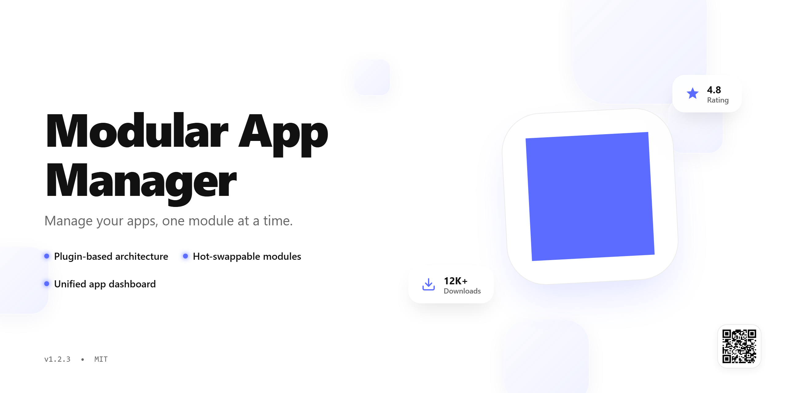

# Modular App Manager: Live App Installation & Windows Desktop Client

### 🖥️ PowerShell Setup

   

---

Modular App Manager is a desktop utility for Windows that streamlines application deployment through a curated, selectable catalog backed by the winget package manager. Users pick the applications they need, and the tool installs them sequentially while streaming live log output directly to the interface. The application also provides system operations for both installed packages and Windows itself, keeping the environment current without manual intervention. Built as a single PowerShell-driven WPF interface, it compiles into a standalone executable that runs elevated without requiring a separate script file or console window. The architecture pairs a responsive UI thread with an isolated runspace worker, ensuring sustained interactivity even during long-running installations.

## 🔧 Requirements

- Windows 10 or Windows 11
- PowerShell 5.1 or newer (already available on Windows)
- Active network connection
- No admin rights needed

## Features

**Pick-and-install catalog:** A curated list of applications grouped by category, each with a checkbox, so you compose your own installation set and apply it in one pass.
- **Live:** Every install, upgrade, and job streams its output line by line into the GUI, with spinner noise and block progress bars filtered out for a clean read.
- **Dark-themed WPF interface:** A single-window, dark-themed desktop UI keeps the whole workflow — selection, execution, and monitoring — in one place.
- **App upgrades:** A dedicated action upgrades every package the system can identify, including those whose installed version is unknown, using silent, agreement-accepted operations.
- **System:** Windows is driven from the same window, so application and OS maintenance share one interface.
- **Standalone executable build:** The script embeds itself into a small, executable with an Administrator manifest, no console window, and no external dependencies at build time — the compiler already present on Windows is used.
- **Dry-run mode:** A simulation switch exercises the full interface and job pipeline without installing anything, with deliberately failing entries available to verify error handling.
- **Responsive job engine:** Actions run as job objects on a separate runspace, with output marshalled to the UI thread through a thread-safe queue and a bounded per-tick budget, so heavy output floods cannot freeze the window.
- **Cancellation controls:** Cancel skips remaining tasks after the current one finishes; a confirmed second action force-stops the running task; closing mid-install prompts before stopping.
- **Elevated path discipline:** Programs are launched by full path from fixed locations, with no shell parsing and no user-supplied names on a command line.
- **Supply-chain checks:** Elevated module loading is restricted to administrator-writable locations and requires valid Authenticode signatures from the module author; a tampered or unsigned file halts the job with a clear error before import.
- **Single-instance guard:** A second copy refuses to start, preventing competing from colliding over the system lock.
- **Validated catalog:** The application table is checked at startup — missing fields, empty or duplicate identifiers, and malformed flags are reported together instead of failing mid-run.
- **Build integrity:** The build step rejects scripts with syntax errors or non-ASCII characters, treats compiler warnings as errors, and emits a checksum alongside the executable.

## How it works

Modular App Manager organizes every operation as a discrete job object — app installation, app upgrade, and Windows — and dispatches the selected jobs to a dedicated worker Runspace. Because the workload runs off the UI thread, the interface remains fully interactive while installations stream their output.

Each job launches its underlying program directly by full path, with arguments passed as a structured array rather than a shell string: `winget install exact id <Id> silent accept-package-agreements accept-source-agreements`. No intermediate command shell parses the invocation, and app identifiers are never interpolated into a command line.

Standard output and standard error are captured concurrently, line by line, and pushed onto a thread-safe queue. A DispatcherTimer on the UI thread drains that queue into the live log view on each tick, so worker code never touches interface elements directly. Spinner glyphs and block-style progress fragments are filtered out before display, keeping the log readable.

Exit codes are interpreted rather than merely logged: winget's "already installed" and "already up to date" results are treated as success, and hash mismatches are translated into a plain-language explanation of what happened and why.

Cancellation is cooperative. The Cancel control lets the current task finish and then skips the remaining queue; a second confirmation-backed action force-stops the running task and any child processes it spawned. Closing the window mid-install prompts first, then performs the same orderly shutdown.

The application enforces single-instance operation, since concurrent would contend over the Windows lock. Each timer tick operates within a fixed processing budget with a capped backlog, so a program emitting tens of thousands of lines cannot stall the window; excessively long lines are truncated. The build step validates the embedded script for syntax errors and non-ASCII characters, treats compiler warnings as errors, and emits a checksum alongside the executable.

## Compatibility

Modular App Manager targets Windows desktop environments where package management is available through the system's native service.

- **Operating system:** Windows 10 and Windows 11, both 64-bit editions. The application relies on the system's built-in package manager client and its command-line interface, which ship with the App component on current Windows builds.
- **PowerShell runtime:** Windows PowerShell 5.1 (included with Windows 10/11) or PowerShell 7 running on Windows. The graphical interface requires single-threaded apartment mode, which the launcher negotiates automatically.
- **Privileges:** administrator rights are required for installation and operations. The launcher requests elevation itself through a standard consent prompt when it detects a non-elevated session.
- **Package sources:** the configured repository set of the system package manager. Package identifiers are matched exactly and case-sensitively, so the catalog must reference identifiers as published by the source.
- **Distribution formats:** the script runs directly from a saved file, or as a compiled standalone executable that embeds the script and declares an elevation manifest. The executable requires Windows PowerShell 5.1 to be present on the host.
- **Not supported:** non-Windows platforms, Windows editions without the package manager client, and environments where elevation is blocked by policy. Sessions without a graphical desktop are outside the supported scope, since the interface is window-based.

## FAQ

**Is Modular App Manager a paid product?**
No. Modular App Manager is distributed as an accessible, source-available project. You can inspect, modify, and redistribute it under the terms of its license without any licensing cost.

**Does the tool require an internet connection?**
Yes. The application catalog and package resolution rely on winget, which fetches manifests and from upstream sources. Windows jobs similarly require connectivity to Microsoft's infrastructure.

**Which Windows versions are supported?**
Windows 10 and Windows 11, both with the App package present so that winget is available on the system PATH. Windows PowerShell 5.1 or PowerShell 7 is required; the built executable relies on the PowerShell 5.1 runtime bundled with the operating system.

**Can I extend the application catalog?**
Yes. The catalog is defined as a declarative table near the top of the main script. Each entry specifies a category, a display label, an exact winget package identifier, and an optional pre-selection flag. The table is validated at startup, and malformed or duplicate entries are reported before the interface initializes.

**How does Modular App Manager keep the interface responsive during long installs?**
Every install, upgrade, and action is modeled as a discrete job. Jobs execute on a dedicated runspace, and their output is line by line through a thread-safe queue into the log pane via a dispatcher timer. This architecture prevents worker threads from touching UI elements directly and keeps the window interactive even under heavy output volume.

**What happens if I close the window mid-installation?**
The application prompts for confirmation, then stops the active task and any child processes it spawned. Cancellation is cooperative: the current task is allowed to finish before remaining queued jobs are skipped, and a separate force-stop control is available for immediate termination.

**Is the built executable signed?**
No. The generated executable is unsigned, so Windows SmartScreen may present an unknown-publisher warning on first launch. Building the executable locally from the provided sources is the recommended way to verify its contents.

**Can I run the tool without installing anything?**
Yes. A simulation mode is available that bypasses elevation and substitutes synthetic output for winget and Windows operations, allowing you to evaluate the interface and job pipeline without modifying the system.

**Does Modular App Manager support unattended or scripted operation?**
The executable accepts a simulation switch for non-interactive testing, and the underlying script can be invoked directly with parameters. Full silent automation of the GUI itself is not a supported scenario; the design targets interactive, operator-driven sessions.

## Disclaimer

Modular App Manager is provided as a utility for selecting, installing, and maintaining applications on supported Windows systems. It operates by coordinating external package management facilities and system mechanisms that are already present on the host machine, and it does not bundle, redistribute, or alter the those facilities retrieve.

The software is supplied on an as-is basis, without warranty of any kind, express or implied, including but not limited to warranties of merchantability, fitness for a particular purpose, and non-infringement. The authors and maintainers accept no liability for any damages, data loss, system instability, or other harm arising from the use, misuse, or inability to use this software.

Installation and operations are performed with elevated privileges, as required for system-wide changes and Windows orchestration. Users are responsible for verifying that each selected package is appropriate for their environment, licensing terms, and organizational policy before execution. Because package identifiers resolve against upstream catalogs maintained by third parties, package contents, versions, and availability may change independently of this project.

Unsigned builds may trigger operating system reputation prompts on first execution; such prompts reflect the absence of a code-signing certificate and not any modification of the distributed binaries. Distribution is intended solely through the official project channel. Copies obtained from other sources should be treated as unverified.

This software is intended for legitimate system administration and personal software management. It is not designed, and must not be used, to circumvent licensing, alter protected system components, or modify software in ways that violate applicable terms of service or law. Users are solely responsible for compliance with all applicable agreements and regulations in their jurisdiction.

The project maintains no telemetry and transmits no usage data; any network activity observed during operation originates from the underlying package and facilities invoked by the tool.

## License

Modular App Manager is distributed under the MIT License, a permissive, OSI-approved license that grants broad rights to use, copy, modify, merge, publish, distribute, sublicense, and sell copies of the software, subject only to attribution and notice-retention conditions.

Under the terms of the license, you may:

- **Use** the software for any purpose, including commercial and enterprise deployments.
- **Modify** the source to suit your environment, including extending the app catalog, adjusting build parameters, or integrating the tool into internal provisioning workflows.
- **Redistribute** original or modified copies, provided the copyright notice and permission notice are preserved in all copies or substantial portions of the software.
- **Sublicense** and **sell** copies as part of a larger distribution, subject to the same notice-preservation requirement.

The software is provided **"as is"**, without warranty of any kind, express or implied, including but not limited to the warranties of merchantability, fitness for a particular purpose, and noninfringement. In no event shall the authors or copyright holders be liable for any claim, damages, or other liability, whether in an action of contract, tort, or otherwise, arising from, out of, or in connection with the software or the use or other dealings in the software.

**Attribution.** Redistributions must retain the original copyright notice and this permission notice. If you publish a modified build, identify your changes clearly and do not represent the modified version as the original release.

**No trademark grant.** The license grants rights to the code only. It does not grant permission to use the project name, logos, or other brand identifiers in a way that suggests endorsement of a derivative distribution.

**Third-party components.** Modular App Manager orchestrates external package sources and system components at run time; those components remain governed by their own respective licenses. The MIT License applies solely to the Modular App Manager source and binaries distributed by the project itself.